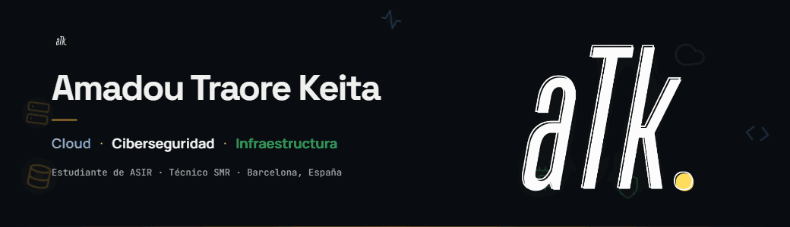

  

  <b>Estudiante de Administración de Sistemas Informáticos en Red (ASIR)</b> 
  Técnico en Sistemas Microinformáticos y Redes (SMR) · Barcelona 
  <i>Construyendo infraestructura segura con proyectos reales y aprendizaje continuo.</i>

  
  
  
  

---

## Perfil

Soy técnico en **Sistemas Microinformáticos y Redes (SMR)** y estudiante de **Administración de Sistemas Informáticos en Red (ASIR)**. Me centro en sistemas, redes, cloud y ciberseguridad, y desarrollo experiencia práctica construyendo laboratorios y proyectos de infraestructura.

Actualmente desarrollo [SecOps Lab](https://github.com/amtraorek/secops-lab) y [CoreLab](https://github.com/amtraorek/corelab), y mantengo [Tecnure Serveis](https://github.com/amtraorek/tecnure-serveis), un proyecto académico de infraestructura IT.

---

## Stack tecnológico

### Cloud

### Infraestructura y sistemas

### Redes y seguridad

### Observabilidad y automatización

---

## Proyectos

### [SecOps Lab — Operaciones de seguridad sobre CoreLab](https://github.com/amtraorek/secops-lab)

> **Activo** · *En desarrollo*

Capa de seguridad de CoreLab con **Wazuh SIEM y 13 agentes monitorizados**, además de una red aislada para pruebas controladas.

`Wazuh` · `Proxmox VE` · `Debian` · `OPNsense` · `Windows 11` · `FreeBSD`

### [CoreLab — Laboratorio de infraestructura self-hosted](https://github.com/amtraorek/corelab)

> **Activo** · *En desarrollo*

Homelab sobre **Proxmox VE** con **12 contenedores LXC, 3 máquinas virtuales y 16 servicios** de red, seguridad, almacenamiento y monitorización. Incluye copias diarias con Proxmox Backup Server.

`Proxmox VE` · `Docker` · `LXC` · `AdGuard Home` · `BIND9` · `Nginx Proxy Manager` · `Prometheus` · `Grafana` · `Uptime Kuma` · `Vaultwarden`

### [tecnure-serveis — Infraestructura IT para Grup Alimentari Guissona](https://github.com/amtraorek/tecnure-serveis)

> **Finalizado** · *Proyecto académico · Nota: 10/10*

Caso académico de infraestructura IT para **Grup Alimentari Guissona**: Active Directory, DNS, Nextcloud, WordPress, correo, copias de seguridad, monitorización y un SOC básico con Wazuh, Suricata y Fail2ban.

`Raspberry Pi` · `Docker` · `Wazuh SIEM` · `Suricata` · `Fail2ban` · `WireGuard` · `AWS`

---

## Certificaciones

| Estado | Certificación | Emisor | Fecha | Verificación |
|---|---|---|---|---|
| ✅ Completada | CCST Cybersecurity | Cisco | Mayo 2026 | [Credly](https://www.credly.com/users/amtraorek) |
| ✅ Completada | SC-900 — Fundamentos de Seguridad, Cumplimiento e Identidad | Microsoft | Marzo 2026 | [Credly](https://www.credly.com/users/amtraorek) |
| ✅ Completada | AI-900 — Fundamentos de Azure AI | Microsoft | Marzo 2026 | [Credly](https://www.credly.com/users/amtraorek) |
| ✅ Completada | AZ-900 — Fundamentos de Azure | Microsoft | Agosto 2026 | [Microsoft Learn](https://learn.microsoft.com/es-es/users/amtraorek/credentials/a4b383e64de4234d) |
| ⏳ En preparación | AWS Certified Cloud Practitioner | AWS | — | [Certificación](https://aws.amazon.com/certification/certified-cloud-practitioner/) |

---

## Contacto

Si quieres hablar sobre **Cloud Computing, Infraestructura, Ciberseguridad** o colaborar en algún proyecto, no dudes en contactar conmigo.

